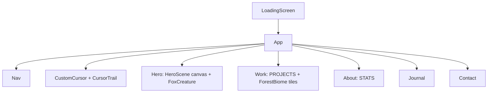

# Studio Foxfire

A one-page agency landing page you can use as a template or showcase. It has a 3D fox that watches your cursor, pixel-art forest backdrops, and scroll choreography. Inspired by [Vessel](https://github.com/0jz/Vessel).


<!-- screenshot: add docs/screenshot.png -->

## What it does

- **A hero creature**: a low-poly fox built only from Three.js primitives. Its head follows the cursor, its pupils dart ahead, and it sways and twitches its ears when idle.
- **Pixel-art forest backdrops**: each section gets its own biome (e.g. evergreen, snowbound), drawn procedurally rather than from image files.
- **Scroll choreography**: GSAP timelines and `ScrollTrigger` reveal headings, stats and the work list.
- **Micro-interactions**: a Motion-driven custom cursor with a paw-print trail, a nav underline, button hover/tap states and work-row arrows.
- **A loading screen** with animated paw prints before the page appears.

## How it works



### Stack split

- **Three.js** via `@react-three/fiber` + `@react-three/drei` (`src/components/HeroScene.jsx`, `FoxCreature.jsx`): the `<Canvas>`, lighting, camera and the fox.
- **GSAP** (`src/sections/*.jsx`): sequenced entrance timelines and `ScrollTrigger` reveals.
- **Motion** (`CustomCursor.jsx`, `Nav.jsx`, `Hero.jsx`, `Work.jsx`): spring cursor, nav underline, hover/tap states, work-row arrow reveal.

## Quickstart

Requires Node.js 18+.

```bash
git clone https://github.com/0jz/Foxfire.git
cd Foxfire
npm install --legacy-peer-deps
npm run dev
```

Open the URL Vite prints (usually http://localhost:5173).

**Why `--legacy-peer-deps`?** A couple of sub-dependencies haven't widened their peer range to React 19 yet, so a plain `npm install` can fail on peer-dependency conflicts. The flag tells npm to skip that check. It doesn't affect runtime behaviour.

## Usage

| Command | What it does |
|---------|--------------|
| `npm run dev` | Start the Vite dev server with hot reload |
| `npm run build` | Production build to `dist/` |
| `npm run preview` | Serve the production build locally |
| `npm run lint` | Lint with oxlint |

### Swap in your data

| What | Where |
|------|-------|
| Projects (title, tag, year, biome) | `PROJECTS` array in `src/sections/Work.jsx` |
| Stats | `STATS` array in `src/sections/About.jsx` |
| Nav links | `LINKS` array in `src/components/Nav.jsx` |
| Contact headline + email (`hello@studio-example.com`) | `src/sections/Contact.jsx` |
| Journal copy | `src/sections/Journal.jsx` |
| Page title | `index.html` |
| Biome colours | `BIOMES` in `src/components/forestBiomes.js` |

Everything else is ready to go.

## Project structure

```
src/
  App.jsx / App.css / index.css    # Page composition and global styles
  sections/                        # Hero, Work, About, Journal, Contact
  components/
    FoxCreature.jsx                # The 3D fox and its cursor-tracking logic
    HeroScene.jsx                  # <Canvas>, lighting, camera
    CustomCursor.jsx, CursorTrail.jsx  # Motion cursor + paw-print trail
    LoadingScreen.jsx, Nav.jsx
    Forest*.jsx, forestBiomes.js   # Pixel-art forest backdrops and biome palettes
    ornaments/                     # Pixel sprites, paw prints, treeline divider
public/                            # favicon.svg, icons.svg
```

## Status & limitations

- Showcase/template: all content is placeholder (projects, stats, email).
- Static front end only: the contact section is a `mailto:` link, not a form.
- Needs WebGL for the hero. Heavy 3D and canvas work may be slow on low-end devices.
- No tests. Lint runs with `npm run lint`.

## License

No license file is included yet. Until one is added, all rights are reserved by the author.
